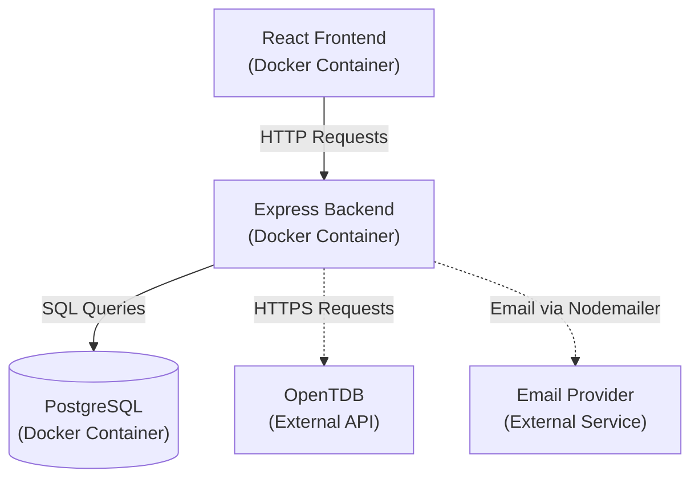
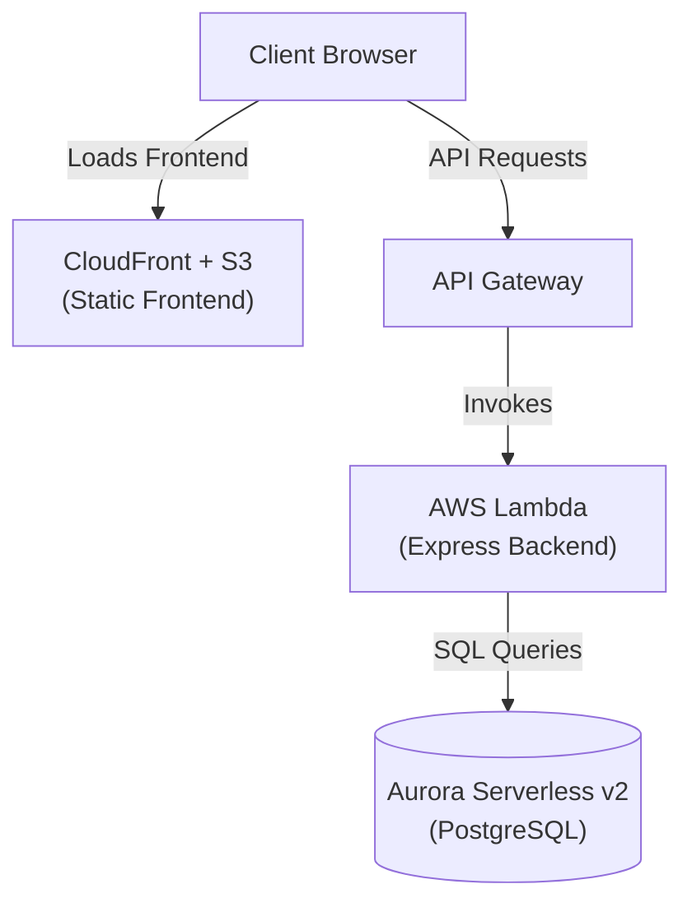

# Quiz App

A full-stack quiz application built with React, Express, and PostgreSQL, featuring user authentication, dynamic quiz generation, and quiz history tracking.

The application uses Docker Compose for local development and AWS serverless services for cloud deployment. Infrastructure is provisioned with Terraform, and deployments are automated through GitHub Actions.

## Features

### User Features
- Create an account, log in securely, and take quizzes.
- Instant feedback on answers.
- User dashboard showing quiz history + recent activity.
- Password reset flow via unique email verification code.

### Technical / Developer Features
- Integration with the external OpenTDB API for dynamic quiz generation.
- Password hashing, user authentication, and input validation.
- Containerized local development using Docker Compose.
- AWS serverless deployment using S3, CloudFront, API Gateway, Lambda, and Aurora Serverless v2.
- Infrastructure provisioning with Terraform.
- Automated frontend and backend deployments using GitHub Actions with AWS OIDC authentication.

## Tech Stack
- **Frontend:** React, Vite
- **Backend:** Node.js, Express
- **Database:** PostgreSQL, Amazon Aurora Serverless v2
- **Containerization:** Docker, Docker Compose
- **Cloud:** AWS Lambda, API Gateway, S3, CloudFront
- **Infrastructure as Code:** Terraform
- **CI/CD:** GitHub Actions, AWS IAM, OIDC

## Local Architecture (Docker Compose)


The frontend, backend, and PostgreSQL database run locally through Docker Compose. The Express backend also communicates with external services to retrieve quiz questions and send password reset emails.

## Cloud Deployment Architecture (AWS)


The React frontend is hosted as static assets in Amazon S3 and delivered through CloudFront. API requests are routed through API Gateway to the Express backend running on AWS Lambda, which communicates with an Aurora Serverless v2 PostgreSQL database.

## Project Structure
```
quiz-app/       
├── .github/
│   ├── workflows/        # GitHub Actions CI/CD
├── client/               # React Frontend             
│   ├── src/
│   ├── Dockerfile
│   ├── index.html
├── server/               # Express Backend        
│   ├── server.js
│   ├── Dockerfile
├── terraform/            # Infrastructure as Code        
│   ├── modules/
│   ├── main.tf
├── .env
├── docker-compose.yml    # Container Orchestration
└── README.md
```

## Local Setup (Docker Compose)

### Prerequisites
- Docker Desktop (Windows/Mac) or Docker Engine (Linux)
- Bash shell (Git Bash recommended for Windows)

### Get Started
1. Clone the repo
   ```bash
   git clone https://github.com/shamitsoni/quiz-app.git
   cd quiz-app
   ```
2. Configure environment variables  
   Copy the provided template and update with your database credentials and (optional) email service settings
   ```bash
   cp .env.example .env
   ```
3. Generate database schemas  
   Run the initialization script, to create init.sql and set the database owner with the PGUSER value from your .env
   ```bash
   ./gen-init.sh
   ```
4. Start services with Docker Compose  
   Build all containers (frontend, backend, and Postgres) and start the stack. For subsequent starts, exclude the --build flag
   ```bash
   docker-compose up --build
   ```
5. Access local servers
   - Frontend: http://localhost:3000
   - Backend: http://localhost:5000
